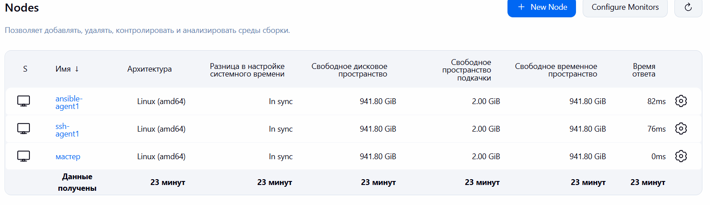
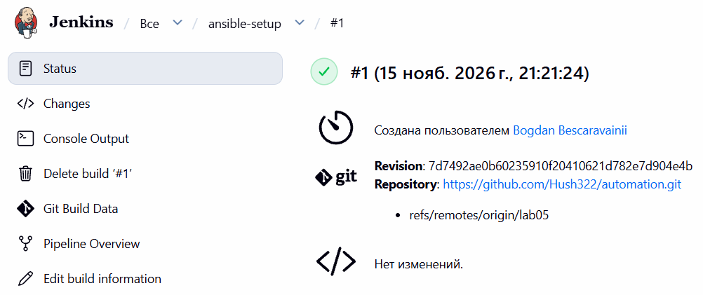
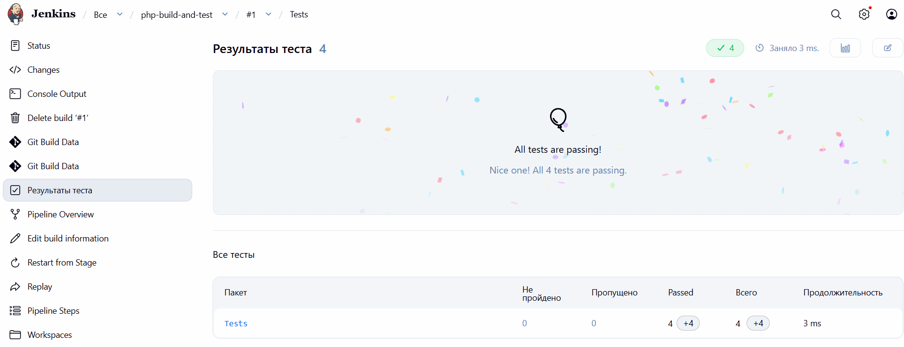
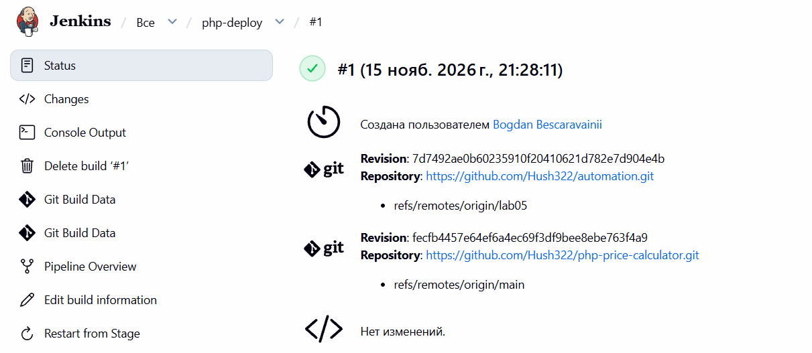
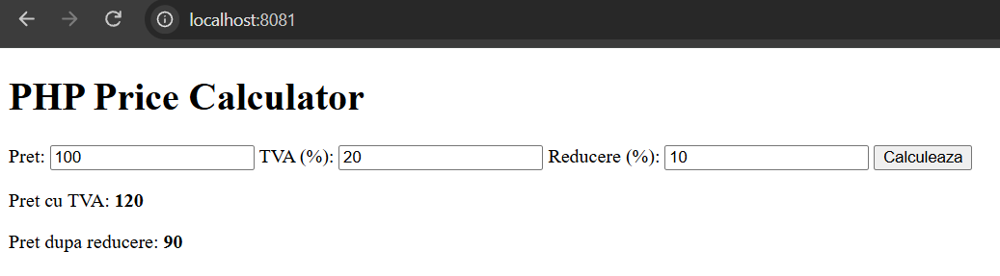

# Laboratorul 05 – Ansible, Jenkins și configurarea automată a unui server de test

## 1. Descrierea proiectului

În acest laborator am extins mediul din lab04 (Jenkins Controller + SSH Agent) cu un **Ansible Agent** și un **server de test**. Ansible configurează serverul (Apache2, PHP, virtual host), iar Jenkins rulează trei pipeline-uri: build + teste, configurarea serverului și deploy-ul aplicației PHP (`php-price-calculator`).

Arhitectura (toate containerele sunt în rețeaua `jenkins-network`):

| Serviciu | Rol |
|---|---|
| `jenkins-controller` | Interfața Jenkins, coordonează pipeline-urile (`restart: unless-stopped`) |
| `ssh-agent` | Agent (label `php-agent`): Composer + PHPUnit |
| `ansible-agent` | Agent (label `ansible-agent`): rulează playbook-urile Ansible |
| `test-server` | Ubuntu cu SSH; configurat de Ansible; web pe `localhost:8081` |

Structura lab05:

```text
lab05/
├── compose.yaml
├── Dockerfile.ssh_agent
├── Dockerfile.ansible_agent
├── Dockerfile.test_server
├── scripts/            (entrypoint-uri: scriu cheile publice în authorized_keys)
├── screenshots/        (capturi de ecran pentru raport)
├── ansible/
│   ├── ansible.cfg
│   ├── hosts.ini
│   ├── group_vars/all.yml
│   ├── templates/php-app.conf.j2
│   ├── setup_test_server.yml
│   └── deploy_php.yml
└── pipelines/
    ├── php_build_and_test_pipeline.groovy
    ├── ansible_setup_pipeline.groovy
    └── php_deploy_pipeline.groovy
```

## 2. Chei SSH

Sunt necesare trei perechi de chei (generate în folderul `keys/`, care este în `.gitignore`):

```bash
mkdir -p keys
ssh-keygen -t rsa -b 4096 -m PEM -f keys/jenkins_ssh_agent     -N ""   # Jenkins -> ssh-agent
ssh-keygen -t rsa -b 4096 -m PEM -f keys/jenkins_ansible_agent -N ""   # Jenkins -> ansible-agent
ssh-keygen -t rsa -b 4096 -m PEM -f keys/ansible_server        -N ""   # ansible-agent -> test-server
```

Cheile **publice** se pun în fișierul `.env` (ignorat de Git):

```bash
cat > .env <<EOT
JENKINS_SSH_AGENT_PUBKEY="$(cat keys/jenkins_ssh_agent.pub)"
JENKINS_ANSIBLE_AGENT_PUBKEY="$(cat keys/jenkins_ansible_agent.pub)"
ANSIBLE_SERVER_PUBKEY="$(cat keys/ansible_server.pub)"
EOT
```

Cheile **private** se adaugă în Jenkins (*Manage Jenkins → Credentials → Global → Add Credentials → SSH Username with private key*):

| ID | Username | Cheia privată | Utilizare |
|---|---|---|---|
| `ssh-agent-key` | `jenkins` | `jenkins_ssh_agent` | conectarea nodului `ssh-agent1` |
| `ansible-agent-key` | `jenkins` | `jenkins_ansible_agent` | conectarea nodului `ansible-agent1` |
| `ansible-server-key` | `ansible` | `ansible_server` | folosită în pipeline pentru ansible-agent → test-server |

## 3. Configurarea Jenkins Controller

1. `docker compose up -d --build`
2. Deschid `http://localhost:8080`, introduc parola inițială (`docker exec jenkins-controller cat /var/jenkins_home/secrets/initialAdminPassword`) și creez utilizatorul administrator.
3. Instalez pluginurile: **Docker**, **Docker Pipeline**, **GitHub Integration**, **SSH Agent** (plus pluginurile sugerate).

## 4. Configurarea SSH Agent

`Dockerfile.ssh_agent` este cel din lab04 (bazat pe `jenkins/ssh-agent`, cu PHP-CLI, extensii PHP, Composer, Git). Serviciul `ssh-agent` primește cheia publică prin `JENKINS_AGENT_SSH_PUBKEY`. În Jenkins nodul `ssh-agent1` (label `php-agent`, host `ssh-agent`, credențiala `ssh-agent-key`, remote root `/home/jenkins/agent`) se configurează ca în lab04.

## 5. Crearea și configurarea Ansible Agent

`Dockerfile.ansible_agent` pornește de la `ubuntu:24.04` și instalează `ansible`, Java (necesar pentru `agent.jar`), `openssh-server`, `git` și `python3`. Se creează utilizatorul `jenkins`, iar `sshd` este configurat să accepte doar chei. La pornire, `entrypoint-agent.sh` scrie cheia publică din variabila de mediu în `authorized_keys`.

În Jenkins se creează nodul permanent:

| Parametru | Valoare |
|---|---|
| Name | `ansible-agent1` |
| Remote root directory | `/home/jenkins/agent` |
| Labels | `ansible-agent` |
| Launch method | Launch agents via SSH |
| Host | `ansible-agent` |
| Credentials | `ansible-agent-key` |

Ansible folosește cheia `ansible_server` pentru conectarea la serverul de test; aceasta este furnizată pipeline-ului din Jenkins Credentials (`ansible-server-key`) prin `withCredentials` și parametrul `--private-key`. Utilizatorul de conectare (`ansible`) este setat în `hosts.ini`.

## 6. Crearea serverului de test

`Dockerfile.test_server` (Ubuntu 24.04) instalează `openssh-server`, `sudo` și `python3` (necesar pentru modulele Ansible). Se creează utilizatorul `ansible` cu `sudo` fără parolă, iar `sshd` permite doar autentificarea cu chei (`PasswordAuthentication no`). `entrypoint-test-server.sh` scrie cheia publică `ansible_server.pub` în `/home/ansible/.ssh/authorized_keys`. Portul 80 al serverului este publicat pe `localhost:8081`.

## 7. Playbook-ul Ansible

**`hosts.ini`** – definește grupul `test_servers` cu hostul `test-server` (utilizator `ansible`, port 22).

**`setup_test_server.yml`** – taskuri:
1. actualizarea cache-ului apt;
2. instalarea Apache2;
3. instalarea PHP și a extensiilor (`libapache2-mod-php`, `php-xml`, `php-mbstring`, `php-curl`);
4. activarea modulului `rewrite` (`community.general.apache2_module`);
5. crearea directorului rădăcină `/var/www/php-app/public`;
6. o pagină implicită, creată doar dacă nu există (`force: false`);
7. configurarea virtual host-ului din șablonul `php-app.conf.j2`;
8. dezactivarea site-ului implicit și activarea celui al aplicației (`a2dissite` / `a2ensite`, idempotent prin `removes` / `creates`);
9. pornirea Apache2; handler-ul `Restart Apache` repornește serviciul când se schimbă configurația.

Deoarece containerul nu rulează systemd, modulul `service` este folosit cu `use: service`.

**`deploy_php.yml`** – copiază `src/` și `public/` din proiect în `/var/www/php-app`, verifică sintaxa PHP și testează că aplicația răspunde cu HTTP 200 (`uri`).

Pentru ca aplicația să aibă o pagină web, în proiectul `php-price-calculator` a fost adăugat fișierul `public/index.php`, care folosește clasa `PriceCalculator`.

## 8. Pipeline-urile Jenkins

Pentru fiecare se creează un job de tip **Pipeline** cu *Pipeline script from SCM* (Git, `https://github.com/Hush322/automation.git`, branch `*/lab05`):

| Job | Script Path | Agent |
|---|---|---|
| `php-build-and-test` | `lab05/pipelines/php_build_and_test_pipeline.groovy` | `php-agent` |
| `ansible-setup` | `lab05/pipelines/ansible_setup_pipeline.groovy` | `ansible-agent` |
| `php-deploy` | `lab05/pipelines/php_deploy_pipeline.groovy` | `ansible-agent` |

- **php_build_and_test** – clonare, `composer install`, `phpunit --log-junit`, raportare cu `junit`.
- **ansible_setup** – clonare, verificare conexiune (`ansible -m ping`), rularea `setup_test_server.yml`.
- **php_deploy** – clonare proiect PHP, clonare playbook-uri, rularea `deploy_php.yml` cu `-e project_dir=$WORKSPACE/php-app`.

Ordinea de rulare: `ansible-setup` → `php-build-and-test` → `php-deploy`.

## 9. Rezultate și testarea aplicației

Toate cele trei pipeline-uri au rulat cu succes (`Finished: SUCCESS`):

- `ansible-setup` – `PLAY RECAP`: `ok=12 changed=10 unreachable=0 failed=0`;
- `php-build-and-test` – testele PHPUnit au trecut (4 teste, 4 aserțiuni);
- `php-deploy` – aplicația a fost copiată pe serverul de test și a răspuns cu HTTP 200.

După deploy, aplicația este disponibilă în browser la `http://localhost:8081`.







## 10. Răspunsuri la întrebări

**Care sunt avantajele utilizării Ansible pentru configurarea serverelor?**
- Este *agentless*: folosește doar SSH și Python pe server, fără software suplimentar.
- Playbook-urile YAML sunt declarative și ușor de citit.
- Taskurile sunt idempotente: rularea repetată nu modifică un server deja configurat (la a doua rulare majoritatea taskurilor apar ca `ok`, nu `changed`).
- Configurația este cod, deci poate fi versionată în Git și reutilizată pe multe servere.
- Reduce erorile manuale și se integrează bine cu CI/CD (Jenkins).

**Ce alte module Ansible există pentru gestionarea configurației?**
`apt`/`yum`/`package` (pachete), `service`/`systemd` (servicii), `copy`/`template`/`lineinfile`/`blockinfile` (fișiere), `file` (permisiuni, directoare), `user`/`group`, `git`, `command`/`shell`, `cron`, `docker_container`, `ufw`/`firewalld`, `uri`, `apache2_module`, `mysql_db`/`postgresql_db`, `synchronize`.

**Ce probleme ați întâmpinat și cum le-ați rezolvat?**

1. *Docker nu era disponibil în WSL* – comanda `docker` nu era găsită în distribuția WSL. Soluție: activarea opțiunii *WSL integration* pentru distribuția folosită în Docker Desktop (Settings → Resources → WSL integration).
2. *Jenkins s-a oprit după instalarea pluginurilor* – după restartul cerut de Jenkins, containerul `jenkins-controller` a ieșit și `localhost:8080` nu mai răspundea (`ERR_CONNECTION_REFUSED`). În Docker, procesul principal s-a încheiat, iar containerul nu avea politică de repornire. Soluție: repornirea cu `docker compose up -d` și adăugarea `restart: unless-stopped` în `compose.yaml`.
3. *Credențiale SSH asemănătoare* – `ssh-agent-key` și `ansible-agent-key` au același username (`jenkins`) și se deosebesc doar după ID. Soluție: verificarea ID-urilor și a log-ului nodului până la starea *Online*; cheia `ansible-server-key` (username `ansible`) se folosește doar în pipeline.
4. *Lipsa unei pagini web în proiectul PHP* – proiectul conținea doar clasa `PriceCalculator` și testele, deci nu exista ce să fie verificat în browser. Soluție: adăugarea fișierului `public/index.php`.
5. *Containerele nu rulează systemd* – modulul `service` nu poate gestiona Apache prin systemd. Soluție: `use: service` în taskurile Apache.
6. *Ansible are nevoie de Python pe server* – imaginea Ubuntu nu îl include. Soluție: `python3` instalat în `Dockerfile.test_server`.

## 11. Concluzie

Am creat un mediu format din Jenkins Controller, un agent SSH pentru build/teste, un agent Ansible și un server de test. Serverul a fost configurat automat cu Ansible (Apache2, PHP, virtual host), iar aplicația PHP a fost testată și instalată prin pipeline-uri Jenkins, fără pași manuali pe server.
